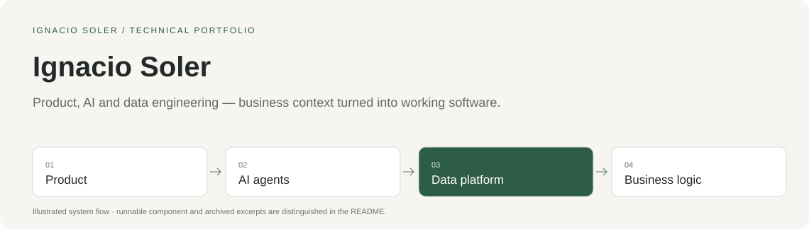

# Ignacio Soler

**Founder · Product, AI and data engineering**

I build software that connects business workflows, data models and AI agents. I have 6+ years in tech and founded **Chals AI**, where I have worked across product design, frontend, backend, automation and managed data infrastructure.

## Selected projects

Four technical cases from the evolution of Chals AI. Each has an architecture overview, design decisions, a source tour and a component you can run locally with synthetic data.

| Project | What I built | Explore |
|---|---|---|
| [Invoice Automation](https://github.com/nasoler123/invoice-automation) | OCR, line-level financial checks and Holded integration. Runnable Python sample and source walkthrough. | [Source tour](https://github.com/nasoler123/invoice-automation/blob/main/docs/code-tour.md) · [Español](https://github.com/nasoler123/invoice-automation/blob/main/docs/LEEME.md) |
| [Financial Modeling SaaS](https://github.com/nasoler123/financial-modeling-saas) | React/TypeScript financial product, driver formulas, projections and Google Sheets adaptation. Offline AST evaluator. | [Source tour](https://github.com/nasoler123/financial-modeling-saas/blob/main/docs/code-tour.md) · [Español](https://github.com/nasoler123/financial-modeling-saas/blob/main/docs/LEEME.md) |
| [AI Agent Harness](https://github.com/nasoler123/ai-agent-harness) | Agent harness case study: skill registry, controlled tool dispatch, context budgets, prompt caching and durable execution. | [Source tour](https://github.com/nasoler123/ai-agent-harness/blob/main/docs/code-tour.md) · [Español](https://github.com/nasoler123/ai-agent-harness/blob/main/docs/LEEME.md) |
| [Data Platform and MCP](https://github.com/nasoler123/data-platform-mcp) | BigQuery/dbt data platform and MCP case study. Offline semantic-coherence checks, SQL, OAuth and contract excerpts. | [Source tour](https://github.com/nasoler123/data-platform-mcp/blob/main/docs/code-tour.md) · [Español](https://github.com/nasoler123/data-platform-mcp/blob/main/docs/LEEME.md) |

## The product journey

**2024–2025:** OCR, financial checks and accounting automation. **2025–2026:** a financial modeling SaaS with editable drivers and dashboards. **2026:** an agent harness, a Google Sheets adapter, and then a data platform exposing governed metrics through MCP.

The invoice system remains in use by several restaurants and an advisory. Data engineering and BI through agents reached approximately five clients in total. These are adoption statements from my own work; the proprietary frontend did not acquire customers. The public repositories distinguish original implementations, synthetic demonstrations and their verification scope.

## How I work

I connect product and business requirements with implementation: model the process, define the data and metrics, build the interface and runtime, then verify the result. My development workflow uses AI extensively, with explicit tool contracts, context boundaries and checks around execution.

**Product and UI:** React, TypeScript, Google Apps Script. **Backend and agents:** Python, APIs, Agents SDK, skills and MCP. **Data:** BigQuery, dbt, Fivetran, Parquet and DuckDB. **Operation:** Google Cloud, Cloud Run, Tasks, Firestore and OAuth/PKCE.

## En español

Soy Ignacio Soler, founder de Chals AI. Construyo producto, automatizaciones, agentes e infraestructura de datos con criterio de negocio. Arriba puedes abrir cuatro casos técnicos, consultar las decisiones y comprobar componentes del código con ejemplos sintéticos.

[LinkedIn](https://www.linkedin.com/in/ignacio-soler-esteban/) · [Repositorios del portfolio](https://github.com/nasoler123?tab=repositories)
